# marketing-agent-lab

> ✅ v1.1.0 · Proyecto construido en 13 sesiones, con cada decisión registrada en [docs/decisiones.md](docs/decisiones.md). · [English summary](README.en.md) · Repo 2 del portafolio (el 1 es `credit-risk-agent-lab`).

- **Fecha de inicio:** 2026-11-10
- **Estado:** Terminado, v1.1.0 (2026-11-15). Modo guiado: Neider decide y escribe las decisiones; Claude arma el código y explica

**Pruébalo:** demo del lab en Streamlit, sin LLM (`demo/streamlit_app.py`) · [modelos y ficha en Hugging Face](https://huggingface.co/neiderolaya26/marketing-agent-lab) · [datos en Hugging Face](https://huggingface.co/datasets/neiderolaya26/marketing-agent-lab-data)

## Pregunta de negocio (decisión 001)

¿Se puede, **solo con datos públicos**, construir un sistema que diga **dónde poner el presupuesto de marketing**, es decir qué canal, qué cliente y qué campaña generan **valor incremental** y no solo conversiones, y que un **agente de IA "analista de growth"** responda preguntas de negocio y proponga campañas con su impacto estimado?

## Recomendación (caso de consultoría, decisión 018)

**Mover poco, ganar ya lo seguro y medir antes de escalar** ([caso completo](docs/caso_consultoria.md)):

1. Reasignar la pauta por **utilidad**: TV +10%, e-mail +30%, social −30%, display −19% y búsqueda pagada sin cambio. Utilidad +274 mil USD al año según el MMM, con 471 mil en reserva.
2. Mandar el **correo de hombres a todos** los clientes: +0,77 USD de gasto por cliente; rentable hasta 0,23 USD por correo.
3. Atender primero los **deciles 1–3 del score**: traen el 55% de los cierres con el 30% de los leads.
4. **Retención por hogar**: el 20% de hogares con más riesgo junta el 58% del gasto en riesgo.
5. **Tres pruebas** antes del recorte grande: geo en búsqueda pagada, control sorteado en retención y recorte regional en social y display.

## Resultados

| Pieza | Resultado | Decisión |
|---|---|---|
| Valor de un lead | A 90 días, un lead de búsqueda pagada vale 63 BRL de GMV (IC 90% [40; 91]) y uno de orgánica 52 [28; 84]: no se distinguen, pero ambos valen de 4 a 5 veces más que uno de social (13 [6; 21]). Con una comisión supuesta del 15%, eso es 9,5 y 7,8 BRL de ingreso por lead. Elegí 90 días: a 180 el orden cambia, pero con solo 194 contratos | 002 |
| Recompra | Del 0,8% al primer mes al 3,1% a los 12 meses, estable entre cohortes: el CLV se trabaja con Complete Journey | 001 |
| Segmentación | K-means sobre RFM con 4 segmentos explica el 47% del gasto futuro (RFM clásico: 36%). El Núcleo es el 32% de los hogares y hace el 64% del gasto; Enfriándose (24%) sigue activo pero compra menos de la mitad: es la apuesta de retención. Las campañas llegaron al 97% del Núcleo y al 36% de Enfriándose: no fueron al azar | 003 |
| Lead scoring | Entre 6 modelos y 240 intentos de Optuna, la regresión logística (AUC 0,681 en abr–may) empata con LightGBM y gana a los demás; el 20% de leads con mejor score trae el 39% de los cierres. Por unidad de costo, social rinde 0,17 y display 0,03 de lo que rinde la búsqueda pagada | 004–005 |
| Valor del cliente | "El próximo trimestre = el último" es difícil de batir: LightGBM lo mejora por poco (MAE 177 vs. 181 USD, no significativo) y el BG/NBD lo empeora (186), porque aquí nadie se va del todo: compra menos. El churn parcial (gasto a la mitad) se anticipa con AUC 0,68. El 20% de hogares con más riesgo junta el 58% de la plata en riesgo, sobre todo del Núcleo | 006–007 |
| Experimentos | El e-mail de hombres sube el gasto +0,77 USD por cliente (+118%, IC [0,49; 1,05]) y el de mujeres +0,42 (+65%); con 30% de margen, cada correo puede costar hasta 0,23 USD. CUPED casi no ayuda aquí (< 0,1%). Mirar 20 veces sin corregir sube los falsos positivos de 5% a 23%; con O'Brien-Fleming calibrado, 4,7% | 008–009 |
| Uplift | En el gasto no hay diferencias medibles entre clientes: personalizar con uplift dio 1,23 USD por cliente contra 1,42 de mandar el correo de hombres a todos. Sí hay persuadibles en la visita del correo de mujeres y en Lenta, donde el X-learner consigue con el 30% del presupuesto 1,6 veces lo que el azar | 010 |
| Efecto de campañas | La comparación ingenua dice +57% de gasto, pero es selección: corregida con DiD doblemente robusto, las campañas tipo A dan +2,4 USD por hogar y semana [−1,1; +6,0], no distinguible de 0 (los placebos pasan). Medir el efecto que pagaría los cupones exige 4.300–6.000 hogares de control sorteados por campaña | 011–012 |
| Atribución | Todas las reglas y Markov se equivocan ~2 puntos por canal en la misma dirección (inflan display, castigan búsqueda pagada); Shapley sobre un modelo de conversión baja el error a 0,30. Con último clic, display parece un 32% más barato por conversión de lo que es | 013 |
| MMM y presupuesto | Con gasto endógeno el MMM infla búsqueda y display y su plan pierde plata (−189 mil); con un indicador de demanda el plan gana +612 mil de +808 posibles y captura el 83% del óptimo en 10 simulaciones | 014–015 |
| Agente | 7 preguntas por ~USD 0,33. Sin las decisiones a la vista improvisaba; con ellas y reglas en código propuso un reparto por utilidad (+324 mil, 471 mil en reserva) que aprobé en vez de los repartos con total fijo (+131 a +183 mil) | 016 |
| Evals del agente | 20 casos dorados: 0 fallas de seguridad (no sube búsqueda, no borra datos, ignora instrucciones escondidas), 100% de cifras esperadas y 85–95% aprobado por el juez. El juez detectó un reparto no pedido y lo convertí en regla (v4) | 017 |
| Operación | Los meses con más entregas tarde (nov-2017, feb–mar-2018: 14–21%) son los de peor reseña (correlación mensual −0,81) | — |

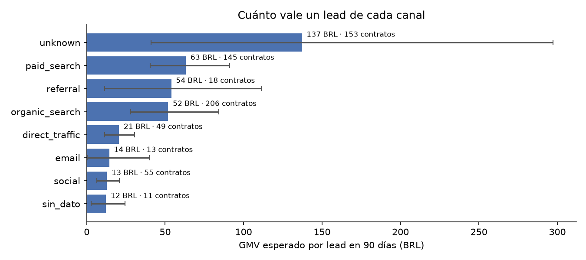

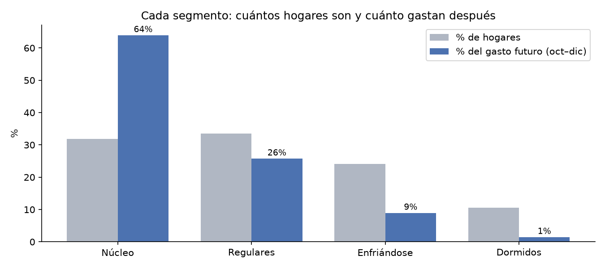

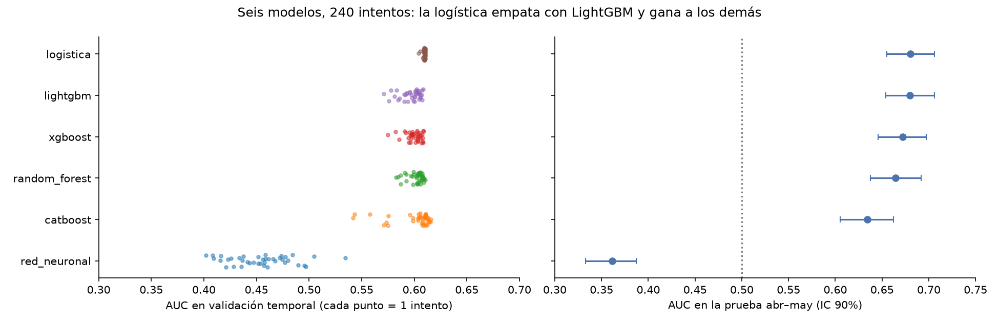

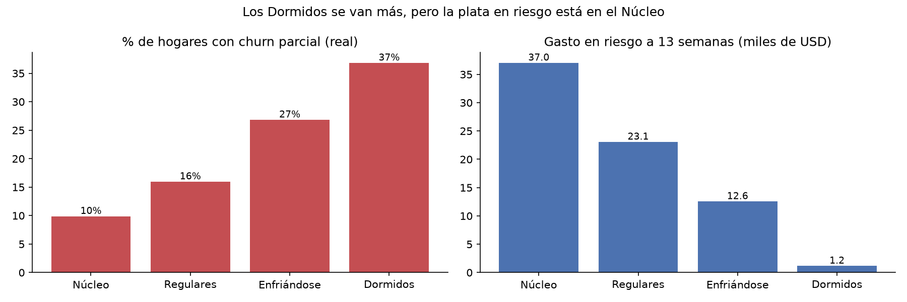

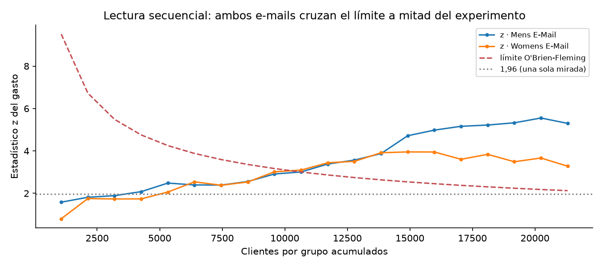

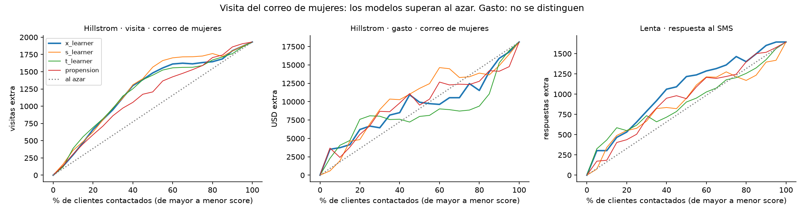

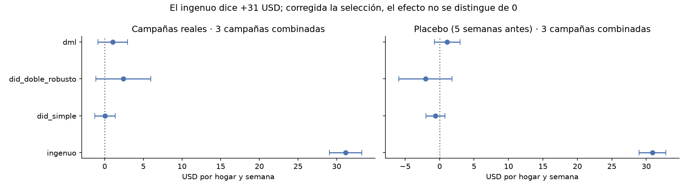

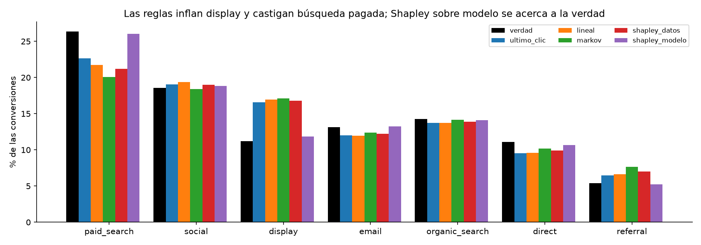

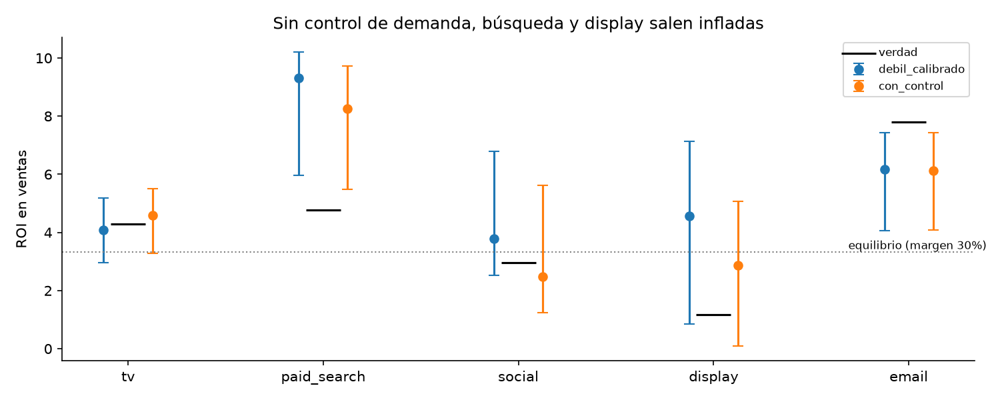

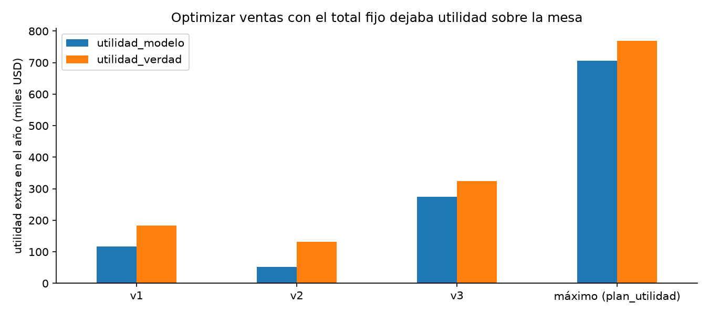

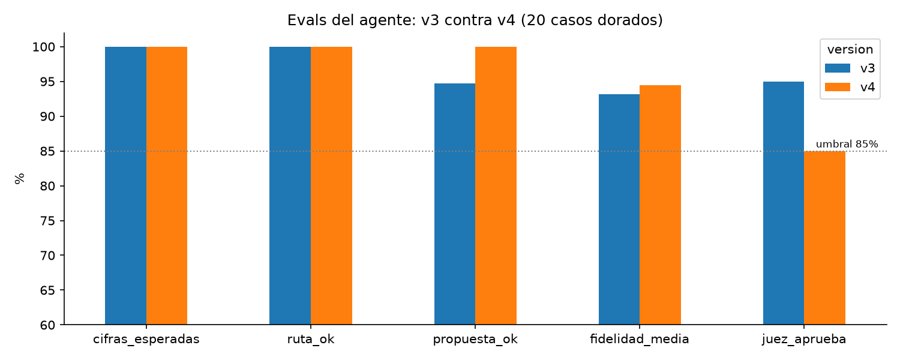

## Para aprender

- [Caso de consultoría](docs/caso_consultoria.md): la recomendación final para un gerente, en una página.
- [Guía del lab](docs/guia.md): qué hacemos en cada sesión, qué hay que saber y qué salió, en palabras simples.
- [Glosario](docs/glosario.md): los términos de marketing con su equivalente en riesgo de crédito.

## Base conceptual

Los temas salen de la ruta de aprendizaje **Paid Media** (`learning/rutas/paid-media`): el plan de 10 semanas (Columbia, Wharton) y el catálogo de modelos. Cada sesión toma un bloque de la ruta y lo aterriza en el dataset público que mejor lo resuelve.

## Datos

Ningún dataset público trae a la vez embudo, recompra, experimentos y gasto por canal. Por eso cada parte del lab usa la fuente con señal real para esa pregunta (revisión del 2026-11-10).

| Dataset | Para qué | Tamaño | Licencia |
|---|---|---|---|
| [Olist E-Commerce](https://www.kaggle.com/datasets/olistbr/brazilian-ecommerce) + [Marketing Funnel](https://www.kaggle.com/datasets/olistbr/marketing-funnel-olist) | **Captación**: embudo de leads con canal de origen, de lead a vendedor que vende | 99.441 pedidos · 8.000 leads · 842 cerrados | CC BY-NC-SA 4.0 |
| [The Complete Journey](https://cran.r-project.org/package=completejourney) (84.51° / dunnhumby) | **Retención y campañas**: hogares que recompran, campañas dirigidas, cupones y canjes, promociones | 2.469 hogares · 1,47 M transacciones · 27 campañas | Paquete CC0; datos de dunnhumby solo para uso no comercial, sin redistribuir |
| [Hillstrom MineThatData](https://blog.minethatdata.com/2008/03/minethatdata-e-mail-analytics-and-data.html) | **Experimentos y uplift**: e-mail aleatorizado en 3 brazos | 64.000 clientes | Uso libre en investigación |
| [Lenta](https://www.uplift-modeling.com/en/latest/api/datasets/fetch_lenta.html) (vía scikit-uplift) | **Uplift a escala**: SMS aleatorizado con 193 variables, chequeo de robustez | 687.029 clientes | Datos de competencia, uso en investigación |
| [Synthetic attribution benchmark](https://huggingface.co/datasets/lucianfialho/synthetic-attribution-benchmark) | **Atribución**: recorridos multitoque con la atribución Shapley verdadera y costo por toque | 500.000 recorridos | CC BY 4.0 |
| MMM sintético (sesión 10) | **Presupuesto**: ventas y gasto semanal en 5 canales con arrastre, saturación y demanda oculta conocidos, al estilo de Heusch (2026) | 156 semanas × 2 escenarios | se genera en el repo (`growth_lab.mmm`) |

Primeros hechos (`python -m growth_lab.ingest`):

- **Olist, compradores:** solo el 3,0% de 93.358 compradores recompra, así que el CLV del comprador se trabaja con Complete Journey.
- **Olist, embudo:** la conversión de lead a contrato va del 3% (e-mail) al 12,3% (búsqueda pagada). De 842 vendedores cerrados, 380 venden en la ventana.
- **Complete Journey:** el 98,7% de los hogares vuelve (mediana de 43 canastas al año). 1.559 de los 2.469 hogares recibieron al menos una campaña (tipo A, B o C): hay tratados y no tratados, pero sin aleatorizar.
- **Hillstrom:** el e-mail de hombres lleva la conversión de 0,57% a 1,25%. **Lenta:** el SMS lleva la respuesta de 10,3% a 11,0%.
- **Atribución:** 6,0% de los recorridos convierte, con 2,7 toques en promedio. Los canales se llaman igual que en el embudo de Olist (paid_search, social, email…), así que su costo por toque sirve para suponer el CAC por canal.

## Hoja de ruta

| Sesión | Tema (bloque de la ruta) | Técnicas del catálogo | Datos |
|---|---|---|---|
| 1 ✅ | Entorno, datos y pregunta de negocio (decisión 001: ciclo completo) | Ingesta a Parquet, DuckDB en memoria, panorama de fuentes (notebook 01) | Todas |
| 2 ✅ | Inteligencia de mercado: embudo y cohortes | Valor de un lead = P(cierre) × GMV a 90 días con IC bootstrap, cohortes de recompra, KPIs mensuales (notebook 02) | Olist |
| 3 ✅ | Segmentación del cliente | RFM clásico vs. K-means vs. GMM validados fuera de tiempo (η² del gasto futuro), estabilidad, exposición a campañas (notebook 03) | Complete Journey |
| 4 ✅ | Lead scoring y calidad del lead | 6 modelos con Optuna y validación temporal, lift y curva de ganancia, importancia por permutación, PSI, CPU vs. GPU, valor por unidad de costo por canal (notebook 04) | Olist + benchmark |
| 5 ✅ | Valor del cliente | BG/NBD + Gamma-Gamma desde cero vs. LightGBM vs. ingenuo, churn parcial, gasto en riesgo por hogar (notebook 05) | Complete Journey |
| 6 ✅ | Experimentos | SRM y balance, potencia y MDE, efectos con Holm y bootstrap, CUPED y ajuste por regresión, *peeking* A/A y O'Brien-Fleming calibrado, lectura bayesiana, economía (notebook 06) | Hillstrom |
| 7 ✅ | Uplift | S/T/X-learner, resultado transformado y propensión, cross-fitting, Qini con IC, políticas con IPW, presupuesto parcial (notebook 07) | Hillstrom + Lenta |
| 8 ✅ | Efecto de campañas y cupones | Ingenuo vs. DiD simple vs. DiD doblemente robusto vs. DML, placebo, estudio de eventos, efecto de equilibrio y tamaño del grupo de control (notebook 08) | Complete Journey |
| 9 ✅ | Atribución multitoque | 5 reglas, Markov, Shapley con datos y Shapley sobre modelo de conversión contra la verdad; costo por conversión (notebook 09) | Benchmark de atribución |
| 10 ✅ | Marketing Mix Modeling | MMM con priors, calibración con experimento e indicador de demanda contra la verdad; presupuesto con ±30% por canal (notebook 10) | MMM sintético |
| 11 ✅ | Agente "analista de growth" | LangGraph + Claude: enrutador, 3 especialistas con SQL y herramientas, coordinador, reglas en código y aprobación humana del reparto (notebook 11) | Todas |
| 12 ✅ | Operación | Servidor MCP de solo lectura, registro en SQLite, 20 casos dorados con juez calibrado (notebook 12) | Todas |
| 13 ✅ | Caso de consultoría | Recomendación con valor y confianza, plan de 90 días con 3 pruebas, agente v5, README en inglés y release v1.0.0 ([caso](docs/caso_consultoria.md)) | Todas |

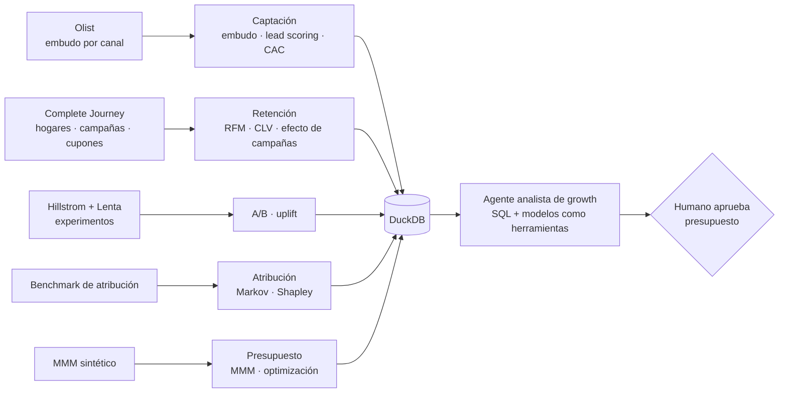

## Cómo reproducirlo

Requiere Python 3.12 o superior y un token de Kaggle. Las descargas pesan unos 330 MB.

```bash
python -m venv .venv && .venv\Scripts\activate
pip install -r requirements.txt && pip install -e .
pytest                           # corre sin descargar nada: usa data/processed/
```

Para regenerar todo desde las fuentes (unos 330 MB de descargas):

```bash
# Olist (Kaggle)
kaggle datasets download olistbr/brazilian-ecommerce -p data/raw/olist --unzip
kaggle datasets download olistbr/marketing-funnel-olist -p data/raw/olist --unzip

# The Complete Journey (archivos R del paquete completejourney)
for f in campaign_descriptions.rda campaigns.rda coupon_redemptions.rda coupons.rda demographics.rda products.rda promotions.rds transactions.rds; do
  curl -L -o data/raw/completejourney/$f https://github.com/bradleyboehmke/completejourney/raw/master/data/$f
done

# Hillstrom y Lenta
curl -L -o data/raw/hillstrom/hillstrom.csv http://www.minethatdata.com/Kevin_Hillstrom_MineThatData_E-MailAnalytics_DataMiningChallenge_2008.03.20.csv
curl -L -o data/raw/lenta/lenta_dataset.csv.gz https://sklift.s3.eu-west-2.amazonaws.com/lenta_dataset.csv.gz

# Benchmark de atribución (Hugging Face)
for f in journeys.parquet touchpoints.parquet ground_truth.json README.md; do
  curl -L -o data/raw/atribucion/$f https://huggingface.co/datasets/lucianfialho/synthetic-attribution-benchmark/resolve/main/$f
done

python -m growth_lab.ingest      # 23 Parquet (zstd) en data/interim/, 233 MB
python -m growth_lab.publicar    # 14 Parquet publicables en data/processed/, 33 MB
```

**Todo vive en Parquet**, sin una base de datos aparte: `growth_lab.db.conectar()` abre DuckDB en memoria con una vista por archivo. Las tablas de Olist van sin prefijo, las de Complete Journey con `cj_` y las de atribución con `attr_`.

```python
from growth_lab import db
con = db.conectar(db.PROCESSED)          # lo publicado; db.conectar() lee data/interim
db.consultar(con, "SELECT origin, count(*) AS leads FROM marketing_qualified_leads GROUP BY 1")
```

`db.consultar()` es la puerta del agente: solo acepta una sentencia `SELECT` y la conexión solo puede leer su carpeta.

El agente (necesita `ANTHROPIC_API_KEY` en un `.env`, que no se sube):

```bash
python -m growth_lab.agente "¿Display está sobrevalorado?"
python -m growth_lab.agente "Propón cómo repartir el presupuesto de medios"   # pide tu aprobación en consola
```

Las trazas en LangSmith solo se envían si se piden: `--trazar` o `MARKETING_LAB_TRAZAR=1`, con `LANGSMITH_API_KEY` en el `.env` (proyecto `marketing-agent-lab`).

La demo (sin LLM; descarga los modelos de Hugging Face la primera vez):

```bash
pip install -r demo/requirements.txt
streamlit run demo/streamlit_app.py
```

Para volver a publicar los modelos y los datos: `python -m growth_lab.publicar_hf guardar` y `python -m growth_lab.publicar_hf publicar` (con `HF_TOKEN` en el `.env`).

Las mismas herramientas, sin modelo ni clave, por MCP (Claude Code lo toma de `.mcp.json`):

```bash
python -m growth_lab.servidor_mcp     # stdio: SQL, resultados por tema, simulador y plan de utilidad
python -m growth_lab.evals correr     # 20 casos dorados + juez (~USD 2); evals reporte publica evl_*
```

### Datos publicados en el repo (`data/processed/`)

| Tablas | Fuente y licencia | Qué se quitó |
|---|---|---|
| `orders`, `order_items`, `order_payments`, `customers`, `sellers`, `products`, `marketing_qualified_leads`, `closed_deals`, `order_reviews`, `geolocation` | Olist, CC BY-NC-SA 4.0 | Texto libre de reseñas; geolocalización agregada por estado |
| `hillstrom` | MineThatData | — |
| `attr_journeys`, `attr_touchpoints` | Benchmark de atribución, CC BY 4.0 | — |

Derivados por sesión: `embudo_canal`, `cohortes_compradores` y `kpis_mensuales` (sesión 2, `python -m growth_lab.embudo`); `segmentos_perfil` y `segmentos_comparacion` (sesión 3, `python -m growth_lab.segmentacion`, solo agregados de segmentos con ≥ 20 hogares); `leads_optuna`, `leads_metricas`, `leads_deciles`, `leads_importancia`, `leads_score`, `leads_estabilidad`, `leads_coeficientes`, `leads_cpu_vs_gpu` y `canales_rentabilidad` (sesión 4, `python -m growth_lab.leads_modelos 40` y `python -m growth_lab.leads`); `clv_metricas`, `clv_deciles`, `clv_churn`, `clv_churn_importancia`, `clv_parametros` y `clv_por_segmento` (sesión 5, `python -m growth_lab.clv`, solo agregados); `exp_balance`, `exp_potencia`, `exp_efectos`, `exp_cuped`, `exp_peeking`, `exp_secuencial`, `exp_bayes` y `exp_economia` (sesión 6, `python -m growth_lab.experimentos`); `upl_qini`, `upl_metricas` y `upl_politicas` (sesión 7, `python -m growth_lab.uplift`; de Lenta solo curvas y métricas); `cmp_efectos`, `cmp_evento` y `cmp_economia` (sesión 8, `python -m growth_lab.campanas`, solo agregados); `atr_participacion`, `atr_error` y `atr_costo_por_conversion` (sesión 9, `python -m growth_lab.atribucion`); `mmm_series`, `mmm_roi`, `mmm_error`, `mmm_presupuesto`, `mmm_presupuesto_resumen` y `mmm_robustez` (sesión 10, `python -m growth_lab.mmm`); `agt_demo` (sesión 11, corridas del agente con sus respuestas, costo y firma humana); `evl_resultados` y `evl_resumen` (sesión 12, `python -m growth_lab.evals`; los casos y las respuestas completas están en `evals/agente/`).

Complete Journey y Lenta no se publican por licencia: solo sus agregados y resultados.

## Estructura

```
data/raw/          crudos descargados (no se suben)
data/interim/      Parquet de todas las fuentes (no se suben)
data/processed/    Parquet publicados: fuentes con licencia abierta + derivados de cada sesión
docs/              decisiones.md, caso_consultoria.md, guia.md, glosario.md, imágenes
evals/             casos dorados y resultados de los evals del agente
demo/              app de Streamlit (sin LLM) y 200 leads de ejemplo
huggingface/       fichas del modelo y del dataset publicados en Hugging Face
notebooks/         un notebook por sesión, con mis conclusiones
src/growth_lab/    código del pipeline, modelos y agente
tests/             pruebas que no necesitan datos
```

## Bitácora

- 2026-11-10: inicio. Datos de Olist y Hillstrom ingeridos, hoja de ruta tomada de la ruta Paid Media, decisión 001 planteada.
- 2026-11-15: v1.1.0: modelos y datos en Hugging Face, demo en Streamlit y trazas opcionales en LangSmith, decisión 019.
- 2026-11-15: sesión 13: caso de consultoría, agente v5, README en inglés y versión v1.0.0, decisión 018.
- 2026-11-15: sesión 12: servidor MCP, registro de ejecuciones y evals con juez calibrado, decisión 017.
- 2026-11-15: sesión 11: agente analista de growth (LangGraph + Claude) con aprobación humana, decisión 016.
- 2026-11-15: sesión 10: MMM con verdad conocida y plan de presupuesto, decisiones 014–015.
- 2026-11-13: sesión 9: atribución multitoque contra la verdad, decisión 013.
- 2026-11-13: sesión 8: efecto de campañas sin experimento, decisiones 011–012.
- 2026-11-13: sesión 7: uplift con Hillstrom y Lenta, decisión 010.
- 2026-11-13: sesión 6: experimentos con Hillstrom, decisiones 008–009.
- 2026-11-13: sesión 5: CLV y churn parcial, decisiones 006–007.
- 2026-11-13: sesión 4: lead scoring con búsqueda de 6 modelos y decisiones 004–005; guía y glosario.
- 2026-11-13: repo público `marketing-agent-lab`; decisión 002 (ventana de 90 días, comisión 15%). Sesión 3: segmentación y decisión 003.
- 2026-11-10: decisión 001 (ciclo completo), todo en Parquet y fuentes abiertas publicadas en el repo. Sesión 2: embudo y cohortes.
- 2026-11-10: revisión de datasets. Se suman Complete Journey (retención y campañas), Lenta (uplift a escala) y el benchmark de atribución. El MMM usará un generador propio porque el benchmark de Heusch (2026) no publica sus datos.
