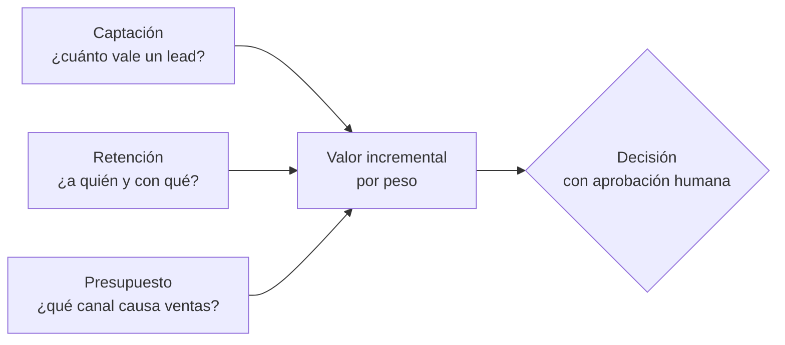
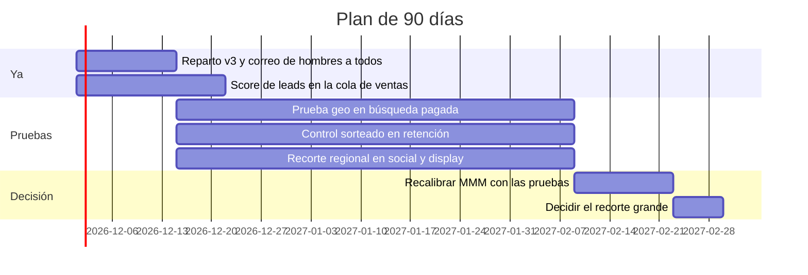

# Caso de consultoría: dónde poner el próximo peso de marketing

**Para:** gerencia de marketing y growth · **De:** Neider Olaya · **Fecha:** 2026-11-15 · **Decisión:** 018

> Las cifras salen de datos públicos (Olist, The Complete Journey agregado, Hillstrom, benchmark de atribución) y de un MMM sintético con verdad conocida. Se presentan como si fueran de una sola empresa para mostrar el método, no como resultados de un cliente real.

## Resumen ejecutivo

**Recomendación: mover poco, ganar ya lo seguro y medir antes de escalar.**

1. **Reasignar la pauta por utilidad, no por ventas:** TV +10%, e-mail +30%, social −30%, display −19% y búsqueda pagada sin cambio. El gasto anual baja de 8.760 a 8.289 mil USD (471 mil en reserva) y la utilidad sube **+274 mil según el MMM** (+324 mil con la verdad del simulador).
2. **Mandar el correo de hombres a todos los clientes:** +0,77 USD de gasto por cliente frente a no mandar nada. Cada correo puede costar hasta 0,23 USD y seguir siendo rentable.
3. **Atender primero los leads de los deciles 1–3 del score:** concentran el 55% de los cierres con el 30% de los leads.
4. **Retención por hogar, no por segmento:** el 20% de hogares con más riesgo junta el 58% de los 73.848 USD de gasto en riesgo.
5. **Tres pruebas antes de mover más plata:** geo en búsqueda pagada, control sorteado en retención y recorte regional en social y display. El recorte grande que sugiere el MMM (gasto −25%, +706 mil de utilidad según el modelo) espera esos resultados.

## El problema

El equipo reparte el presupuesto mirando conversiones y último clic. La pregunta es otra: **¿qué canal, qué cliente y qué campaña generan valor incremental?** Valor incremental es lo que no habría pasado sin la acción, descontado lo que costó.

## Lo que encontramos

| Pregunta | Hallazgo | Implicación |
|---|---|---|
| ¿Cuánto vale un lead? | Búsqueda pagada 9,47 BRL de ingreso por lead y orgánica 7,78; social 1,93 y display 0,35 (comisión supuesta del 15%) | Pagar por lead solo hasta su CPL de equilibrio |
| ¿Sirve el lead scoring? | Logística con AUC 0,68 en meses nuevos; el decil 1 cierra 1,9 veces el promedio | Ordenar el trabajo de ventas por score |
| ¿Quién se va? | Nadie se va del todo: compra menos. El churn parcial se anticipa con AUC 0,68 | Priorizar hogares por gasto en riesgo |
| ¿Funcionan los correos? | Correo de hombres +0,77 USD por cliente (IC [0,49; 1,05]); personalizar con uplift no le gana a mandarlo a todos | Correo de hombres a todos, sin modelo |
| ¿Funcionaron las campañas con cupones? | La comparación ingenua dice +57%, pero es selección. Corregida: +2,4 USD por hogar y semana [−1,1; +6,0] | No se sabe: falta un grupo de control sorteado |
| ¿Qué canal causa las ventas? | El último clic infla a display (+5,4 puntos) y castiga a búsqueda; un modelo de conversión con Shapley se equivoca 0,30 puntos | No repartir con último clic |
| ¿Cuánto rinde el próximo peso? | Con margen del 30% el equilibrio es un ROI de 3,33. Al margen solo e-mail (3,66) y búsqueda (3,51, inflada) lo pasan; social 1,67 y display 1,85 | Bajar social y display |
| ¿El MMM es confiable? | Sin un indicador de demanda, su plan pierde plata; con él captura el 83% del óptimo en 10 simulaciones | Usar el MMM con control de demanda y validarlo con pruebas |

## La recomendación y su valor

| Acción | Valor estimado | Confianza | Qué la puede invalidar |
|---|---|---|---|
| Reparto de la pauta (v3) | +274 mil USD de utilidad al año (MMM) | Media: MMM sintético; dirección validada en 10 simulaciones | Que la prueba de recorte muestre que social o display sí causan ventas |
| Correo de hombres a todos | +0,77 USD de gasto por cliente; rentable hasta 0,23 USD por correo | Alta: experimento aleatorio | Que el costo real por correo supere 0,23 USD |
| Score de leads | El 30% de los leads con mejor score trae el 55% de los cierres | Media: AUC 0,68 | Que el score se degrade (monitorear el PSI de las variables) |
| Retención por hogar | Ordena 73.848 USD en riesgo; el efecto de actuar **no está medido** | Baja hasta tener control sorteado | Que la prueba no muestre efecto |

## Plan de 90 días

- **Prueba geo en búsqueda pagada:** subir búsqueda en unas regiones y mantenerla en otras, comparables. Si el efecto es mucho menor que el que estima el MMM (ROI 8,3), confirma que el modelo la infla.
- **Control sorteado en retención:** dejar sin campaña entre 4.300 y 6.000 hogares elegidos al azar por campaña, lo que hace falta para detectar el efecto que pagaría los cupones.
- **Recorte regional en social y display:** bajar en unas regiones y mirar si las ventas caen más de lo que el MMM espera.

## Cómo se opera

Un **agente analista de growth** responde preguntas con las cifras del lab. Las reglas que mueven plata las revisa el código, no el modelo de lenguaje: cada canal se mueve como máximo ±30%, el total no sube y búsqueda pagada no sube hasta la prueba geo. Además, toda propuesta de reparto necesita una firma humana. En 20 casos de prueba tuvo **0 fallas de seguridad**: no sube búsqueda aunque le digan que gerencia aprobó, no borra datos e ignora instrucciones escondidas en la pregunta.

## Límites

- El MMM y la atribución usan datos **sintéticos** con verdad conocida: muestran el método, no el valor real de estos canales.
- La comisión de Olist (15%) es un supuesto; con 10% o 20% el valor de un lead cambia en proporción.
- Complete Journey solo se publica agregado (licencia); los segmentos tienen al menos 20 hogares.
- Los evals del agente tienen 20 casos: cada respuesta pesa 5 puntos y la última corrección (versión v5) no se midió con evals pagados.
