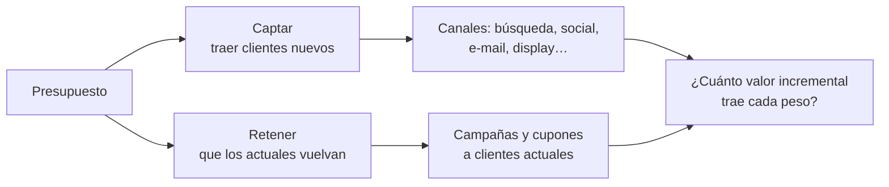

# Guía del lab (para no perderse)

Esta guía explica **qué estamos haciendo, con qué y por qué**, sesión por sesión, en palabras simples. Cada paso sigue el mismo orden:

> **Ahora vamos a…** lo que se hace · **Para esto hay que saber…** los conceptos · **Lo que salió** el resultado

Doy por sabido lo que un analista de riesgo de crédito ya maneja (regresión logística, LightGBM, AUC, KS, bootstrap, cosechas). Lo nuevo es lo propio del marketing, y cuando hay una analogía con crédito la uso. Los términos sueltos están en el [glosario](glosario.md).

---

## Primero: ¿qué pregunta responde el marketing analítico?

En crédito la pregunta es **"¿a quién le presto y en qué condiciones?"**. En marketing es **"¿en qué gasto el siguiente peso para traer o retener clientes que valgan?"**. Se parecen más de lo que parece:

| | Riesgo de crédito | Marketing |
|---|---|---|
| Unidad | Solicitud de crédito | Lead (prospecto) o cliente |
| Qué se predice | Si va a pagar (PD) | Si va a comprar o volver, y cuánto va a valer |
| La trampa | Sesgo de selección: solo ves a los aprobados | Correlación ≠ causa: a quien le mandas campaña ya era buen cliente |
| La palanca | Aprobar, cupo, tasa | Canal, campaña, oferta, presupuesto |
| La métrica de negocio | Utilidad ajustada por riesgo | **ROI incremental**: lo que trajo la acción y no habría pasado sin ella |

El presupuesto de marketing se reparte en dos grandes bolsas, y el lab cubre las dos:

---

## Sesión 1 ✅ · Datos y pregunta de negocio

**Ahora vamos a…** conseguir datos públicos que cubran captación, retención, experimentos y atribución.

**Para esto hay que saber…**

- **Ningún dataset público trae todo.** Las empresas no publican su gasto por canal ni sus experimentos. Por eso cada pregunta usa la fuente que tiene señal para ella.
- **Datos observacionales vs. experimentales.** En los observacionales (Olist, Complete Journey) solo ves lo que pasó, y quien recibió la campaña puede ser distinto de quien no. En los experimentales (Hillstrom, Lenta) se sorteó quién recibía el correo o el SMS, así que la diferencia **sí** es el efecto.
- **Benchmark sintético con la "verdad".** Para la atribución no hay datos reales donde se sepa qué canal causó la venta; el benchmark de Hugging Face se generó con reglas conocidas, así que sí se puede saber si un método acierta.
- **La licencia decide qué se sube.** Olist (CC BY-NC-SA) y el benchmark (CC BY) se pueden publicar; Complete Journey y Lenta no, así que de ellos solo van agregados.

**Lo que salió:**

| Pregunta | Fuente | Qué es cada fila |
|---|---|---|
| Captar | Olist + Marketing Funnel | un lead (vendedor que quiere vender en Olist) con su canal |
| Retener | The Complete Journey | una compra de un hogar en un supermercado de EE. UU. |
| Experimentos | Hillstrom, Lenta | un cliente sorteado a recibir (o no) un correo o SMS |
| Atribución | Benchmark de Hugging Face | un recorrido de un usuario por varios canales |
| Presupuesto | MMM sintético (sesión 10) | una semana de ventas y gasto por canal |

Todo quedó en **Parquet** y se consulta con **DuckDB** en memoria (sin base de datos aparte).

---

## Sesión 2 ✅ · Embudo de captación y cohortes

**Ahora vamos a…** medir cuánto **vale** un lead de cada canal, no solo cuánto convierte.

**Para esto hay que saber…**

- **Embudo:** lead (MQL) → contrato cerrado → vendedor que vende. Muchos canales "convierten" bien en el primer paso y mal en el último.
- **GMV:** lo que vende el vendedor en la plataforma. Olist gana una comisión sobre eso (suponemos 15%).
- **Valor de un lead = P(cierre) × GMV esperado del contrato.** Es la misma lógica de pérdida esperada (PD × LGD × EAD), pero sumando valor.
- **Madurez:** un contrato firmado hace 20 días aún no ha tenido tiempo de vender. Igual que una cosecha joven en crédito, no se mezcla con las maduras.

**Lo que salió:** un lead de búsqueda pagada vale 63 BRL de GMV a 90 días y uno de orgánica 52; no se distinguen entre sí, pero valen de 4 a 5 veces más que uno de social (13). La recompra de compradores es solo 3% al año.

---

## Sesión 3 ✅ · Segmentación de hogares

**Ahora vamos a…** agrupar a los hogares de Complete Journey para saber a quién dirigir el presupuesto de retención.

**Para esto hay que saber…**

- **RFM:** la segmentación clásica. A cada cliente se le pone una nota de 1 a 5 en **R**ecencia (¿hace cuánto compró?), **F**recuencia (¿cuántas veces?) y **M**onto (¿cuánto gastó?). Con esas notas se arman grupos como "Campeones" o "Hibernando".
- **K-means:** en vez de cortar por quintiles, deja que los datos formen k grupos alrededor de "clientes promedio". **GMM** hace lo mismo pero con grupos en forma de nube.
- **Cómo saber si una segmentación sirve:** no basta con que los grupos se vean distintos (eso mide la *silhouette*). Lo que importa es que **predigan** lo que pasa después. Por eso segmentamos con ene–sep y medimos con oct–dic cuánto del gasto futuro explica cada segmentación (**η²**, como un R²).

**Lo que salió:** K-means sobre RFM con 4 grupos explica el 47% del gasto futuro (RFM clásico: 36%). Agregar más variables empeoró. El Núcleo (32% de los hogares) hace el 64% del gasto. Las campañas no se repartieron al azar: llegaron al 97% del Núcleo y al 36% de Enfriándose.

---

## Sesión 4 ✅ · Lead scoring y rentabilidad por canal

**Ahora vamos a…** construir un modelo que ordene los leads por probabilidad de cerrar, buscar el mejor entre varios modelos y comparar canales por valor y costo.

**Para esto hay que saber…**

- **Lead scoring** es el scorecard de originación del marketing: ordena los leads para que ventas llame primero a los mejores. Se mide igual: AUC, lift por deciles, captura del top 20%.
- **Landing page:** la página donde el lead deja sus datos. Cada campaña suele tener la suya, así que la landing resume a qué oferta y mensaje respondió el lead.
- **Variables "previas" sin fuga:** la tasa de cierre de una landing se calcula solo con los cierres que ya se conocían en la fecha del lead, como una variable de buró con fecha de corte.
- **CPL de equilibrio:** lo máximo que se puede pagar por un lead sin perder plata. Si un lead deja 9,5 BRL de comisión, pagar más de 9,5 por él destruye valor.
- **Costo relativo del benchmark:** Olist no publica cuánto gasta por canal. Usamos el costo por conversión del benchmark de atribución en relación con la búsqueda pagada (pagada = 1) para comparar canales sin inventar pesos.
- **Buscar el mejor modelo sin hacer trampa:** Optuna prueba combinaciones de hiperparámetros midiendo con cortes temporales *dentro* del entrenamiento; la prueba (abr–may) se usa una sola vez al final. Si se elige mirando la prueba, el resultado se ve mejor de lo que es.
- **GPU:** acelera modelos grandes; con 3.300 filas es más lenta que la CPU porque pierde más tiempo moviendo datos que calculando.

**Lo que salió:**

- Seis modelos y 240 intentos: la **logística** (AUC 0,681) empata con LightGBM y les gana a XGBoost, Random Forest y CatBoost. Con un empate, gana lo simple.
- El 20% de leads con mejor score trae el 39% de los cierres (el doble que al azar).
- CatBoost fue el mejor en la validación y el peor de los árboles en la prueba: se ajustó al ruido. La red neuronal ordenó al revés porque las tasas previas se duplicaron entre entreno y prueba (deriva, PSI > 2).
- Por unidad de costo, social rinde 0,17 y display 0,03 de lo que rinde la búsqueda pagada: el presupuesto se mueve hacia búsqueda.

---

## Sesión 5 ✅ · Valor del cliente (CLV) y churn parcial

**Ahora vamos a…** estimar cuánto va a gastar cada hogar de Complete Journey en los próximos meses y cuál está por dejar de comprar.

**Para esto hay que saber…**

- **CLV (*customer lifetime value*):** el valor que dejará un cliente en el futuro. Es la pieza que dice cuánto vale la pena gastar para retenerlo.
- **BG/NBD:** un modelo que, solo con recencia, frecuencia y antigüedad, estima cuántas compras más hará cada cliente y la probabilidad de que siga "vivo" (que no se haya ido sin avisar). En retail nadie "cancela": simplemente deja de venir.
- **Gamma-Gamma:** el compañero del BG/NBD que estima cuánto gastará por compra.
- **Churn:** dejar de comprar. Se puede modelar como clasificación (¿compra en los próximos 3 meses?) o como supervivencia (¿cuánto tarda en irse?), igual que el prepago en crédito.

- **Línea base ingenua:** "el próximo trimestre = el último". Si un modelo no le gana a eso, no vale la pena.

**Lo que salió:**

- Lo ingenuo es difícil de batir en un supermercado: se equivoca en 180 USD por hogar. LightGBM baja a 177 (no significativo) y el BG/NBD sube a 186.
- El BG/NBD estima que la probabilidad de irse tras cada compra es 0,1%: aquí nadie se va del todo, compra menos. Por eso el churn se definió como **caída del gasto a menos de la mitad** (18% de los hogares).
- El clasificador LightGBM anticipa ese churn con AUC 0,68; lo que más pesa es la tendencia del gasto reciente.
- Los Dormidos se van más (37%), pero la plata en riesgo está en el Núcleo (37 de 74 mil USD). La retención se prioriza **por hogar**: el 20% con más riesgo junta el 58% de la plata.

---

## Sesión 6 ✅ · Experimentos (A/B)

**Ahora vamos a…** aprender a diseñar y leer un experimento con el correo de Hillstrom: cuánta gente se necesita, si la diferencia es real y cómo reducir el ruido.

**Para esto hay que saber…**

- **A/B test:** se sortea quién recibe cada versión. Como es al azar, los grupos son iguales en todo lo demás y la diferencia es el **efecto causal**.
- **Tamaño de muestra y potencia:** antes de empezar se calcula cuánta gente hace falta para detectar el efecto que te importa. Con poca gente, un efecto real puede no verse.
- **CUPED:** usa lo que cada cliente gastaba **antes** del experimento para quitar ruido. Es como comparar la mejora de cada cliente en vez de su gasto bruto: el mismo efecto se detecta con menos gente.
- **Mirar antes de tiempo (*peeking*):** revisar el resultado todos los días y parar cuando "da significativo" infla los falsos positivos. Las pruebas secuenciales lo corrigen.
- **Enfoque bayesiano:** en vez de un p-valor, da la probabilidad de que B sea mejor que A y cuánto se espera ganar o perder.

- **SRM y balance:** antes de leer el resultado se revisa que el sorteo haya salido bien: grupos del tamaño esperado y parecidos en todo lo previo.

**Lo que salió:**

- El sorteo salió bien (SRM p = 0,90; todas las variables balanceadas).
- El e-mail de hombres sube el gasto +0,77 USD por cliente (+118%) y el de mujeres +0,42 (+65%); el de hombres le gana al de mujeres. Con 30% de margen, cada correo puede costar hasta 0,23 USD y seguir siendo rentable.
- CUPED casi no ayudó (< 0,1%): el gasto de antes no predice el de estas dos semanas. Solo funciona cuando lo previo se parece a lo que se mide.
- Mirar 20 veces sin corregir sube los falsos positivos de 5% a 23%; con O'Brien-Fleming quedan en 4,7% y se pudo parar con la mitad de la muestra.

---

## Sesión 7 · Uplift — lo que viene

**Ahora vamos a…** pasar del efecto promedio ("el correo sube el gasto 0,77 USD") al efecto **de cada cliente**, para mandarle el correo solo a quien le cambia la decisión.

**Para esto hay que saber…**

- **Los cuatro tipos de cliente frente a una campaña:**
  - **Persuadibles:** compran solo si los contactas. Aquí está la plata.
  - **Seguros:** compran igual, con o sin contacto. Contactarlos es gastar de más.
  - **Causas perdidas:** no compran pase lo que pase.
  - **No molestar:** el contacto los espanta (se desuscriben, se molestan).
- **Uplift = P(compra si lo contacto) − P(compra si no).** Un modelo de propensión común ordena por "quién va a comprar", que incluye a los Seguros. El uplift ordena por "a quién le cambio la decisión".
- **S-, T- y X-learner:** tres recetas para estimar el uplift con modelos normales. La T entrena un modelo para tratados y otro para control y resta; la S usa un solo modelo con el tratamiento como variable; la X corrige a la T cuando un grupo es mucho más chico.
- **Curva Qini:** como la curva de ganancia del lead scoring, pero para el efecto incremental: si contacto al top X% según el uplift, ¿cuántas compras **extra** consigo?
- **Por qué hace falta un experimento:** el uplift solo se puede aprender donde se sorteó quién recibía el contacto (Hillstrom, Lenta).

**Lo que vas a decidir tú:** qué modelo de uplift usar, a qué porcentaje de clientes mandarle el correo con un presupuesto fijo y si se personaliza entre el correo de hombres y el de mujeres.

---

## Próximas sesiones

| Sesión | De qué se trata, en una frase |
|---|---|
| 5 · Valor del cliente | Estimar cuánto va a gastar cada hogar en el futuro (CLV) y quién está por dejar de comprar |
| 6 · Experimentos | Diseñar y leer bien un A/B test: cuánta gente se necesita y cómo reducir el ruido (CUPED) |
| 7 · Uplift | Encontrar a quién le cambia la decisión el contacto, para no gastar en quien compraba igual |
| 8 · Efecto de campañas | Medir el efecto de campañas que no fueron al azar, corrigiendo la selección |
| 9 · Atribución | Repartir el mérito de una venta entre los canales y ver cuánto se equivoca el "último clic" |
| 10 · MMM | Estimar con series semanales cuánto aporta cada canal y dónde poner el siguiente peso |
| 11–13 | Agente analista de growth, operación (MCP, evals) y caso de consultoría |
